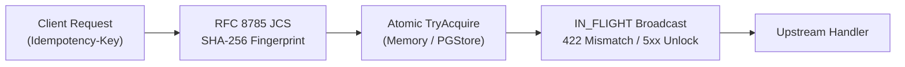

# idemguard

결제, 주문, 포인트 차감처럼 상태가 바뀌는 HTTP API에서 네트워크 재시도나 더블클릭으로 인한 중복 실행을 막는 Go 미들웨어(`pkg/idem`) 겸 L7 리버스 프록시 데몬(`cmd/idemguard`)입니다. 단순 조회 후 실행(Check-Then-Act) 방식은 수십 밀리초 간격의 동시 요청을 막지 못하고 500 오류 응답을 잘못 캐시할 위험이 있어, IETF `Idempotency-Key` 규격에 따라 키 선점, 요청 본문 지문 대조, 실패 시 락 해제를 원자적으로 처리하도록 구현했습니다.

## 요청 상태 전이



1. **선점 (`IN_FLIGHT`)**: 요청이 들어오면 `TryAcquire`로 키를 원자적으로 선점하고 완료 통지 채널(`done`)을 엽니다. 같은 키로 뒤이어 들어온 동시 요청은 `PolicyWaitAndReplay` 설정 시 리더의 `done` 채널이 닫힐 때까지 대기했다가 캐시된 응답(`X-Idempotent-Replayed: true`)을 받고, `PolicyReject409` 설정 시에는 즉시 `409 Conflict`(`Retry-After: 1`)를 돌려받습니다.
2. **지문 검증 (`422 Unprocessable Entity`)**: 요청 본문을 RFC 8785(`gowebpki/jcs`)로 정규화한 뒤 SHA-256 지문을 비교합니다. JSON 키 순서나 공백 차이로 인한 오탐을 없애고, 같은 멱등 키로 다른 본문을 보내면 `422 Unprocessable Entity`(`X-Idempotent-Error: fingerprint_mismatch`)로 거절합니다.
3. **완료 (`COMPLETED`) 및 실패 해제**: `felixge/httpsnoop`으로 원본 `ResponseWriter` 인터페이스(`http.Flusher` 등)를 유지한 채 상태 코드와 본문을 캡처하고, `maps.Clone`/`bytes.Clone`으로 복사해 저장합니다. 하위 핸들러에서 `5xx` 오류나 `panic`이 발생하면 `defer` 복구 블록에서 `Store.Delete`를 호출해 `IN_FLIGHT` 락을 즉시 지워 후속 재시도가 막히지 않게 합니다.

## 저장소 어댑터 (PostgreSQL, 메모리)

`pkg/idem/store.go`의 `Store` 인터페이스(`TryAcquire`, `Complete`, `Delete`, `SweepExpired`)를 기준으로 단일 프로세스용과 분산 환경용 저장소를 교체할 수 있습니다.

- `MemoryStore` (`pkg/idem/memstore.go`): 뮤텍스 기반 인메모리 저장소로, 주기적 만료 수거(`SweepExpired`)와 In-Flight 브로드캐스트 채널을 제공합니다.
- `PGStore` (`pkg/idem/pgstore.go`): 다중 인스턴스 환경에서 `INSERT ... ON CONFLICT DO NOTHING`으로 원자적 선점을 보장합니다.

```text
cmd/idemguard/          signal.NotifyContext 기반 L7 리버스 프록시 데몬 main.go
pkg/idem/
├── record.go           Record 상태(IN_FLIGHT, COMPLETED), ReplayTo 계약
├── fingerprint.go      RFC 8785 JCS 기반 JSON 정규화 및 SHA-256 지문 계산기
├── store.go            Store 인터페이스 정의
├── memstore.go         인메모리 Store와 In-Flight 브로드캐스트 채널
├── pgstore.go          PostgreSQL 분산 Store
├── recorder.go         httpsnoop 기반 상태 코드, 헤더, 바디 캡처 ResponseWriter
└── middleware.go       net/http 미들웨어 Guard 및 prometheus/client_golang 메트릭
```

## 실행 및 테스트

### Go `net/http` 미들웨어 적용

```go
package main

import (
	"net/http"
	"time"

	"github.com/seungwoo7050/idemguard/pkg/idem"
)

func main() {
	store := idem.NewMemoryStore(1 * time.Minute)
	defer store.Close()

	guard := idem.NewGuard(
		store,
		idem.WithWaitPolicy(idem.PolicyWaitAndReplay),
		idem.WithWaitTimeout(5*time.Second),
		idem.WithTTL(24*time.Hour),
	)

	mux := http.NewServeMux()
	mux.HandleFunc("/v1/payments", func(w http.ResponseWriter, r *http.Request) {
		w.Header().Set("Content-Type", "application/json")
		w.WriteHeader(http.StatusOK)
		w.Write([]byte(`{"status":"paid"}`))
	})

	http.ListenAndServe(":8080", guard.Wrap(mux))
}
```

### L7 리버스 프록시 데몬 실행

```sh
make build

./bin/idemguard \
  -listen :8082 \
  -upstream http://localhost:8080 \
  -wait-policy wait \
  -wait-timeout 5s \
  -ttl 24h \
  -max-capture-bytes 1048576
```

헬스체크는 `/healthz`, 선점/재실행/충돌/지문 불일치/실패 해제 카운터 메트릭은 `/metrics`에서 확인할 수 있습니다.

### 단위 및 레이스 테스트

```sh
go vet ./...
go test -race ./...
```

## 운영 시 유의점

- 메모리 고갈을 막기 위해 기본 1MB(`DefaultMaxCaptureBytes`)를 넘는 응답 바디는 캡처하지 않습니다. 대용량 파일 다운로드 엔드포인트는 미들웨어 적용 대상에서 빼거나 `GET` 메서드를 사용해야 합니다.
- `MemoryStore`는 프로세스 재시작 시 캐시가 비워지므로 무중단 재배포나 다중 인스턴스 환경에서는 `PGStore`를 사용해야 합니다.
